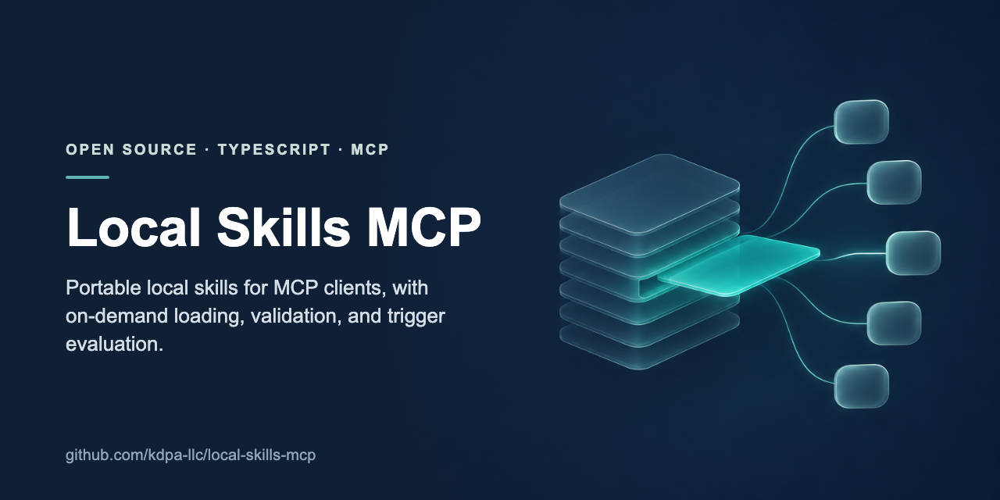
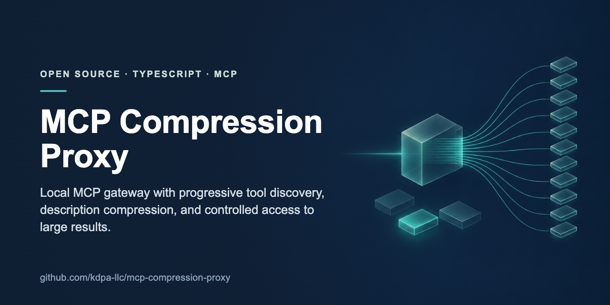

# Rafael Konrath Damaceno

I work on distributed systems, Apache Kafka, cloud reliability and developer productivity. I have 20+ years in software, starting with embedded software, compilers, debuggers and IDEs, and 8+ years leading engineering teams at Amazon and Meta.

At AWS, I lead an Amazon MSK team that owns data plane workflows and the observability agents on Kafka brokers. I stay hands-on: I review designs and code, investigate failures in logs and metrics, and contribute fixes and code changes. I code in Java, Rust and TypeScript.

## Open-source tools

I build these through specification and AI agent orchestration. I set the problem, design, constraints and acceptance bar; agents implement and test in scoped steps; I review and accept the result.

**[Local Skills MCP](https://github.com/kdpa-llc/local-skills-mcp)** serves portable local skills to MCP-compatible clients, with on-demand loading, format validation, hot reload and trigger evaluation. It ships with automated tests, CI, security guidance and contribution docs.

**[MCP Compression Proxy](https://github.com/kdpa-llc/mcp-compression-proxy)** is a local MCP gateway with progressive tool discovery, context-efficient schema access through its CLI or lazy-exposure mode, controlled handling of large results, and aggregation of local and remote servers. It has unit, integration, end-to-end and model-assisted evaluation paths.

This is self-directed open-source work. It doesn't imply any employer deployment or customer adoption.

## Elsewhere

- [LinkedIn](https://www.linkedin.com/in/rafaelkd)
- Co-inventor, [U.S. Patent 10,437,587](https://patents.google.com/patent/US10437587B2/en): developer tooling for parallel code editing
- Talk at SAP d-kom 2015, SAP's internal developer conference, at SAP Labs Latin America: a [coin changer kata in ABAP](https://github.com/moscaverd/coinchangerkata-abap) showing how test-driven development avoids dead code
- [KDPA LLC on GitHub](https://github.com/kdpa-llc)
